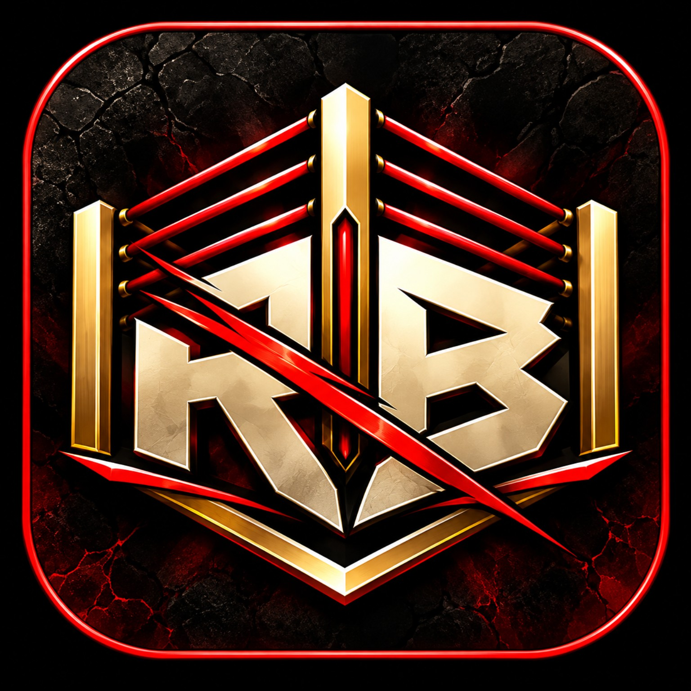

# RINGBOUND
### THE LIVING WRESTLING UNIVERSE

**Your name is unknown. Your next match could change that.**

*Build a wrestler. Chase the spotlight. Write a legacy the world remembers.*

**EVERY MATCH MATTERS. EVERY DECISION ECHOES. EVERY LEGACY IS EARNED.**

[**ENTER THE WORLD**](#welcome-to-ringbound) &nbsp;•&nbsp; [**SEE WHAT'S COMING**](ROADMAP.md) &nbsp;•&nbsp; [**FOLLOW THE JOURNEY**](DEVLOG.md)

[💬 **Join our Discord**](https://discord.gg/RkmATFsk) &nbsp;•&nbsp; [🎤 **Meet us on Reddit**](https://www.reddit.com/r/ringboundmmo/)

*In active development · Community open · Public playtesting not yet announced*

---

## Welcome to RINGBOUND

**What if a wrestling game remembered everything?**

The upset nobody saw coming. The rival who cost you a championship. The unlikely partnership that turned into a legendary tag team. The title reign that defined an era.

**RINGBOUND** is an upcoming **text-driven, persistent online wrestling universe** where you create your own wrestler and build a career in a world shaped by its players.

Your matches become history. Your choices shape your reputation. And the world keeps moving, whether you're standing in the spotlight or fighting to get there.

> **The champion is exhausted. Your rival is watching. The crowd knows something is about to happen.**
>
> *One opening. One decision. A moment everyone might remember.*
>
> **What happens next becomes part of your story.**

*That is the experience we're working to create. RINGBOUND is still in development.*

## 👑 The story doesn't end when the bell rings

| **Make a name for yourself** | **Make every match count** |
| :--- | :--- |
| Start as a newcomer. Train, grow, and fight to become someone worth booking. | Preparation, decisions, stamina, timing, and your opponent all have a part to play. |
| **Make allies. Make enemies.** | **Chase championships. Build history.** |
| Form partnerships, ignite rivalries, and give the wrestling world a reason to talk. | From shocking upsets to dominant title reigns, the moments that matter should live on. |

## 🎙️ A wrestling world that talks back

We're building toward a connected world where:

- **Your reputation follows you.** A big win can open doors. A string of losses can force a new approach.
- **Wrestlers feel different.** A powerhouse, a technician, and a relentless high-flyer should each have their own path to victory.
- **Rivalries have roots.** Yesterday's match can create tomorrow's grudge.
- **Promotions have personalities.** Start small, earn opportunities, and dream of the main event. Player-run promotions are part of the longer-term vision.
- **Legends are made over time.** Championships, turning points, and unforgettable careers can become the history of the world itself.

*These are the goals guiding RINGBOUND. Some systems are in development now; others are part of the longer-term vision.*

## 📖 Wrestling, told differently

RINGBOUND is **text-first by design**.

Imagine a match where the writing makes you feel the pace changing: a missed finisher, a desperate rope break, a smart counter at exactly the right moment. The drama comes from the contest and its consequences.

We're aiming for a wrestling experience where you care about **who is in the ring, why they're fighting, and what winning would mean.**

## 🚧 What's happening behind the curtain?

We're currently focused on making the matches themselves feel believable and exciting. That includes how wrestlers choose moves, react to fatigue, use the ring, and find chances to win.

| **Right now** | **On the horizon** |
| --- | --- |
| Match behavior and pacing | Deeper careers and progression |
| Distinct moves and finishing moments | Promotions and championships |
| Ringside action and officiating | Long-running rivalries and shared history |

**Everything listed is in development or planned.** Research and internal testing do not mean a feature is ready for players.

📅 [**Explore the roadmap**](ROADMAP.md) &nbsp;·&nbsp; 📰 [**Read the latest ringside update**](DEVLOG.md)

## 🎟️ Want to be there from the beginning?

We're building a community of wrestling fans, storytellers, and curious future players.

**Interested in testing RINGBOUND when opportunities become available?** Come meet the community and follow the announcements. We haven't announced a public test or opened applications yet.

**[🥊 How to follow future playtests](PLAYTESTING.md)**

**[💬 Join the RINGBOUND Discord](https://discord.gg/RkmATFsk)**

**[🎤 Join r/ringboundmmo](https://www.reddit.com/r/ringboundmmo/)**

Have a dream feature or a wild wrestling story in mind? [Start here.](COMMUNITY.md)

---

### YOUR CAREER IS WAITING TO BE WRITTEN.

**Every Match Matters. Every Decision Echoes. Every Legacy Is Earned.**

*RINGBOUND is in active development. No public release date or public playtest has been announced.*

